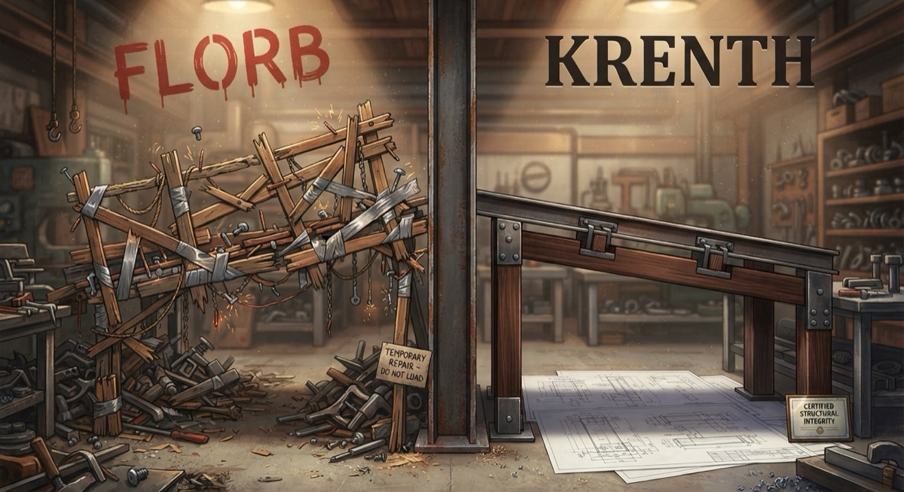

# Example Harper C Bindings

An educational repository illustrating two contrasting approaches to building a C Foreign Function Interface (FFI) for the [Harper](https://github.com) grammar-checking library (`harper-core`) in Rust.



## Two FFI Designs Side-by-Side

This Cargo workspace provides two independent C dynamic libraries (`cdylib`) wrapping `harper-core`, along with matching C example programs:

| Crate | Header | C Example | Design Philosophy | Trade-offs |
| :--- | :--- | :--- | :--- | :--- |
| **`harper-raw`** | `examples/harper_raw.h` | `examples/florb.c` | **Raw pointers & zero-copy slices (`HarperSlice`)** pointing directly into Rust memory. | Maximum speed & zero string copies, but C must strictly obey lifetime rules (no use-after-free) and call `harper_raw_free_*` destructors. |
| **`harper-safe`** | `examples/harper_safe.h` | `examples/krenth.c` | **Generational `SlotMap` handles (`HarperDoc`, `HarperLint`, ...)** + caller-owned string buffers. | Immune to use-after-free, double-free, and wrong-type handles in C, at the cost of `Mutex` lookups and string copies. |

---

## Repository Layout

```text
harper-c/
├── Cargo.toml                  # Cargo workspace root
├── Makefile                    # Builds both Rust dylibs and compiles/runs florb & krenth
├── crates/
│   ├── harper-raw/             # Raw pointer & zero-copy slice FFI (cdylib)
│   └── harper-safe/            # Generational handle-pool FFI (cdylib)
└── examples/
    ├── harper_raw.h            # C header for harper-raw
    ├── florb.c                 # Example consumer for harper-raw
    ├── harper_safe.h           # C header for harper-safe
    └── krenth.c                # Example consumer for harper-safe
```

---

## Building and Running

### Quick Start (with `make`)

The included `Makefile` automatically detects your Cargo `target-directory` (including custom `target-dir` paths in `.cargo/config.toml`), builds both Rust libraries, and compiles and executes both C examples:

```bash
make all      # Build and run both florb and krenth
make florb    # Build and run only the raw/zero-copy example
make krenth   # Build and run only the safe handle-pool example
```

### Manual Build

1. **Build the Rust workspace:**
   ```bash
   cargo build --release
   ```

2. **Compile and run `florb` (`harper-raw`):**
   ```bash
   cc -std=c11 examples/florb.c -Iexamples -Ltarget/release -lharper_raw -Wl,-rpath,target/release -o florb
   ./florb "Plz chek for a error ."
   ```

3. **Compile and run `krenth` (`harper-safe`):**
   ```bash
   cc -std=c11 examples/krenth.c -Iexamples -Ltarget/release -lharper_safe -Wl,-rpath,target/release -o krenth
   ./krenth "Plz chek for a error ."
   ```

---

## Example Output

Running `krenth`:

```text
Using Harper Core version: 3.2.0
3 lints:
Lint 0: 'Helloo' : Did you mean to spell `Helloo` this way? (suggestions: 3)
  Suggestion 0: Replace with: "Hello"
  Suggestion 1: Replace with: "Halloo"
  Suggestion 2: Replace with: "Hellos"
Lint 1: ' ,' : Don't use a space before a comma. Use a space after a comma. (suggestions: 1)
  Suggestion 0: Replace with: ", "
Lint 2: 'Wrld' : Did you mean to spell `Wrld` this way? (suggestions: 3)
  Suggestion 0: Replace with: "Weld"
  Suggestion 1: Replace with: "Wild"
  Suggestion 2: Replace with: "World"
Double-free doc result: false (safely ignored)
Stale doc token count: -1
```

---

## Key FFI Lessons Illustrated

* **Never call C's `free()` on Rust memory:** Rust's allocator may differ from libc's `malloc`/`free`. `harper-raw` exposes `harper_raw_free_string()`, while `harper-safe` writes into caller-provided C buffers so Rust never hands out raw heap pointers at all.
* **Zero-copy slices vs. owned buffers:** `HarperSlice { const char* ptr; size_t len; }` avoids allocations for static strings and lint messages, but is **not null-terminated** (print with `%.*s`) and becomes a dangling pointer as soon as its parent `Lint` is freed.
* **Generational handles (`slotmap`):** Packing a slot index and generation counter into an opaque `uint64_t` struct (`HarperDoc`, `HarperLint`) gives C compile-time type checking between handle kinds and runtime protection against stale or double-freed handles.
* **Character offsets vs. UTF-8 byte offsets:** `harper-core` spans use Unicode scalar (`char`) indices, not UTF-8 byte offsets. Both crates provide `*_get_lint_text()` helpers so C code never slices multi-byte UTF-8 characters mid-codepoint.
